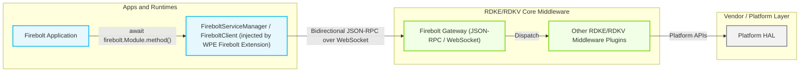
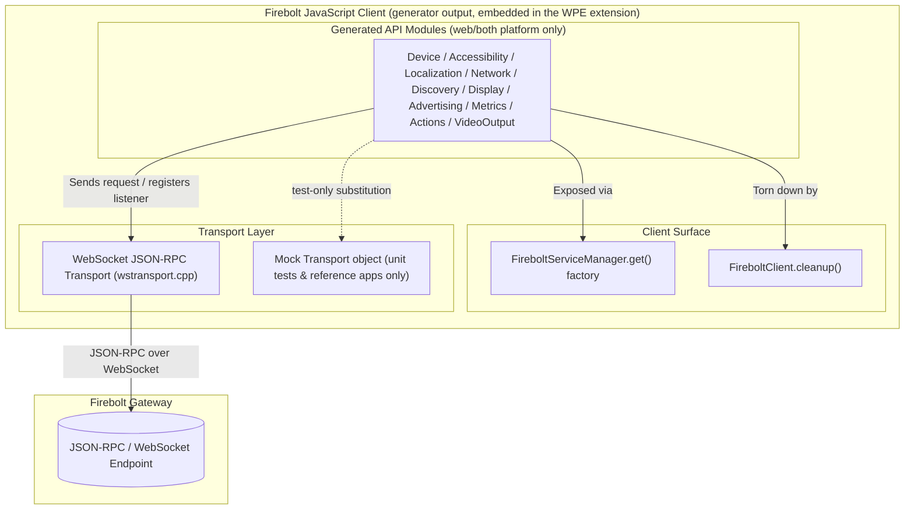
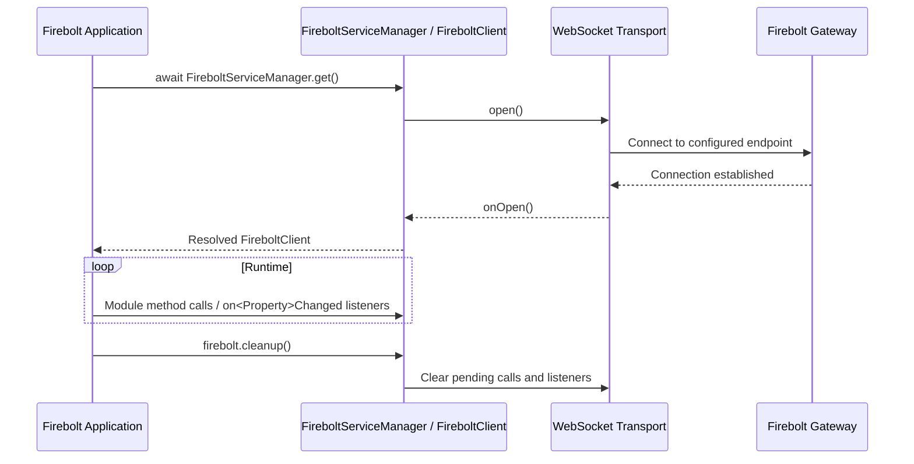
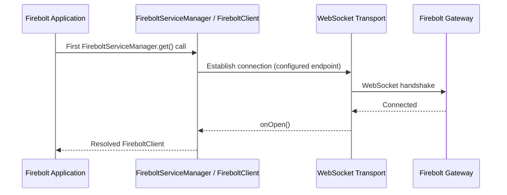
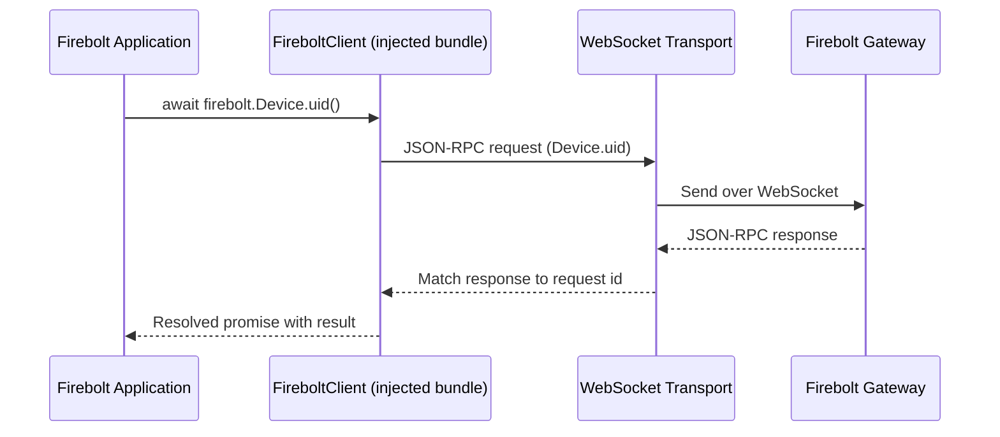
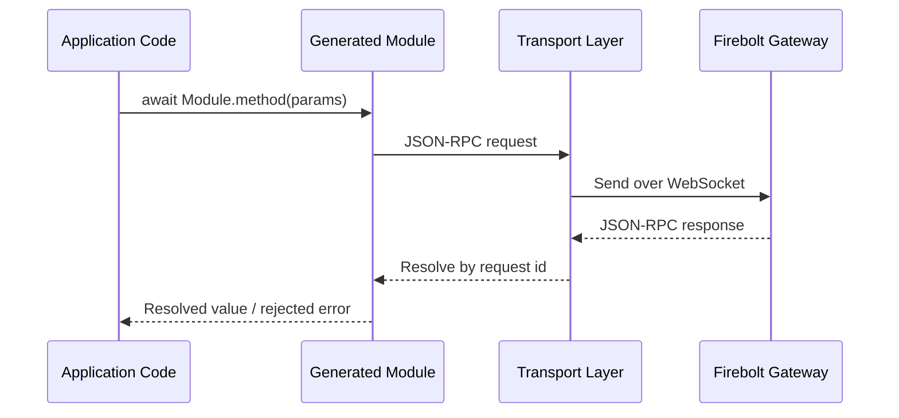
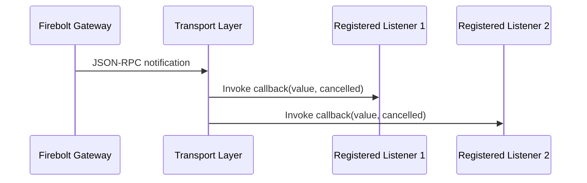

# Firebolt JavaScript Client

Firebolt JavaScript Client (the project [Wiki](https://github.com/rdkcentral/firebolt-js-client/wiki) calls this architecture "Firebolt Web") is RDK's platform-provided replacement for bundling a Firebolt SDK into the application. Instead of the application importing and shipping a client library, a privileged native WPE WebKit browser extension (`webkitExtension/`) injects a JavaScript runtime directly into the page and exposes a `FireboltServiceManager` global. This repository does not contain a hand-written client implementation; it contains the OpenSpec/OpenRPC-driven generator that produces that injected JavaScript bundle, the TypeScript definitions for it, and equivalent headers for native SDK languages (C++, Python, Kotlin/JS, ReScript). See the Wiki's [Firebolt Web](https://github.com/rdkcentral/firebolt-js-client/wiki/Firebolt-Web) page for the full design rationale and the [Firebolt Web Migration Guide](https://github.com/rdkcentral/firebolt-js-client/wiki/Firebolt-Web-Migration-Guide) for app-developer usage.

At the product/stack level, the WPE extension's injected bundle acts as the single point of integration between a Firebolt application and the platform's Firebolt Gateway. Every method call or subscription the application makes is funneled through it as a JSON-RPC call or subscription, so the platform (not the application) owns protocol and transport evolution and can roll out Gateway-side changes without requiring an application update. Firebolt 9 has no capability/permission URN system, so there is no capability negotiation step in this flow. This replaces an earlier model where applications bundled their own Firebolt SDK; per the Wiki's [Direction of Travel](https://github.com/rdkcentral/firebolt-js-client/wiki/Direction-of-Travel) and [Firebolt Web](https://github.com/rdkcentral/firebolt-js-client/wiki/Firebolt-Web) pages, that bundled-SDK model exposed session/WebSocket details to application code (weakening secure-cookie-based auth), added per-app transport overhead, mixed API/protocol/transport/session concerns in one library, and tied every platform fix or API addition to an application redeploy. Moving Firebolt into the platform-provided extension instead keeps session and transport handling under platform control, lets the Gateway evolve independently of application release cycles, and lets both public and private API surfaces grow through schema-driven generation (this repository's OpenSpec/OpenRPC pipeline) rather than hand-written client code.

At the module level, the generated API surface is organized as one module per Firebolt OpenSpec/OpenRPC document: `Device`, `Accessibility`, `Localization`, `Network`, `Discovery`, `Display`, `Advertising`, `Metrics`, `Actions`, and `VideoOutput` (see `openspec/specs/api/`). `Lifecycle2` is also defined, but its OpenSpec `platform` is `native`, so it is not part of this web/WPE client surface — it is only emitted for the native (C++/Python) generators. There are no hand-written `Log`/`Events`/`Settings`/`Platform` support modules in this codebase; the only cross-cutting pieces are the `FireboltServiceManager.get()` factory and a single `cleanup()` method on the returned `FireboltClient`.



**Key Features & Responsibilities:**

- **OpenSpec/OpenRPC-driven API surface**: Each web-available module is authored once as an `openspec/specs/api/<module>/spec.md` document, derived into a formal `src/openrpc/<module>.json` OpenRPC 1.2.4 contract, and parsed into a shared canonical AST that every generator reads, so method names, parameters, and result shapes stay consistent across TypeScript, the injected JavaScript bundle, and the native headers.
- **Promise-based getters with built-in change notifications**: Methods declared under `properties` in the spec (for example `Device.hdr()`, `Accessibility.audioDescription()`, `Network.connected()`) return a promise for the current value and expose a subscribe method, usually named `on<Property>Changed`. The current intent subscription is `Actions.onIntent`, not `Actions.onIntentChanged`. The callback receives two parameters, `(value, cancelled)` — transport-error handling and explicit `firebolt.cleanup()` both cancel listeners by invoking them with `(null, true)` — and the subscribe call returns `Promise<() => void>`, which resolves to an unsubscribe function after the Gateway acknowledges the subscription. Await this promise before using the unsubscribe function. There is no separate shared `Events.listen`/`once`/`clear` module; each property exposes its own subscribe method directly.
- **No capability system**: Firebolt 9 removed the capability/permission URN model used by earlier SDK versions, so generated methods are not tagged with capability URNs and there is no capability manifest step.
- **Platform-scoped generation, not a sliced SDK config**: each spec (and optionally each individual action/property/event) declares `platform: web | native | both` (`openspec/specs/_meta/spec-format.md`), which determines which generators run for it — `ts`/`res`/`kt` for `web`/`both`, `cpp`/`py` for `native`/`both`. There is no `sdk.config.json` slicing step; scoping is driven by these per-spec/per-API `platform` tags together with the CLI's own `--modules`/`--targets` flags.
- **Single global entry point, no fallback module**: the only way an app obtains the client is `await FireboltServiceManager.get()`, resolved once the extension's WebSocket transport to the Firebolt Gateway opens. There is no bundled "default platform values" fallback module — if the transport cannot connect, `get()` does not resolve.
- **Mock transports for local development and tests only**: `src/generators/inject-js.test.ts` and `references/firebolt-cert-app.html` (with `?mock=true`) exercise the generated bundle against an in-process mock transport object. `references/firebolt-type-reference-app` is an IDE/type-checking fixture and does not provide a mock transport. Mock transport substitution is a test/reference-app technique, not a shipped runtime feature or a separate "Mock-Firebolt" server component.
- **IDE-first TypeScript support over the old SDK**: compared to the previous `@firebolt-js/firebolt-js` bundled SDK (a runtime dependency with limited type safety), `@rdkcentral/firebolt-js-types` is a dev-only dependency that the [Firebolt Web Migration Guide](https://github.com/rdkcentral/firebolt-js-client/wiki/Firebolt-Web-Migration-Guide) documents as giving full intellisense, hover documentation, and "Go to Definition" navigation for the `FireboltServiceManager` pattern, including in plain JavaScript via `jsconfig.json` + `checkJs: true` and JSDoc annotations — not just in TypeScript projects.

---

## Design

The client is built around code generation rather than hand-written API bindings: OpenSpec Markdown specs (`openspec/specs/api/<module>/spec.md`) describe every property, action, event, and type, an AI-assisted derivation step turns them into formal `src/openrpc/*.json` OpenRPC 1.2.4 documents (per `openspec/config.yaml`'s pipeline), and `src/cli.ts` parses those documents into a single canonical, language-neutral AST (`src/ast/builder.ts`). A registry of per-language generators (`src/generators/*.ts`) then reads that AST and emits, among others, `generated/ts/<Module>.d.ts` (one file per module, via `typescript.ts`), the standalone `generated/inject-js/firebolt-inject.js` bundle (via the `inject-js` target), and `generated/inject-js/firebolt-inject.d.ts` (the published type definitions, via `inject-js-types.ts`). The separate `webkit-builder` target in `inject-js.ts` emits `generated/inject-js/firebolt-webkit-builder.js`, which `scripts/minify-webkit-builder.cjs` minifies with an ES2015 target into `webkitExtension/resources/firebolt-builder.js` for embedding in the extension. This keeps every target in lockstep with one spec-authored source of truth instead of several hand-maintained copies. There is no `rpc-only`/`property:readonly`/`notifier`/`capabilities` tagging system; a method's shape (call vs. subscribe) is driven by whether the spec declares it under `actions`/`events` or `properties`.

TypeScript coverage is produced by two independent generators reading the same AST but emitting different shapes: `typescript.ts` emits one `declare namespace Firebolt { namespace <Module> { ... } }` file per included module under `generated/ts/`. Its `ts` target is registered for the web platform, so the dispatcher excludes native-only methods and types and skips modules with no remaining members; `Lifecycle2` is not emitted. `inject-js-types.ts` emits the single, published `firebolt-inject.d.ts` — it filters to `web`/`both` modules only, and in addition to the same namespace declarations it generates explicit `<Module>Module` interfaces plus the `FireboltClient`/`FireboltServiceManager` types that actually match the injected runtime pattern. Only the `inject-js-types.ts` output ships to app developers, as `@rdkcentral/firebolt-js-types` (see `package/package.json`); `generated/ts/` is not published anywhere.

Northbound, the injected bundle exposes one property per Firebolt module on the `FireboltClient` object returned by `FireboltServiceManager.get()`; the application calls these as promise-returning functions or `on<Property>Changed` subscriptions and calls `cleanup()` when done. Southbound, every call is translated into a JSON-RPC request and sent over a transport connection to the platform's Firebolt Gateway; JSON-RPC responses and unsolicited notifications are routed back through the same transport to resolve promises or invoke registered listeners.

The IPC mechanism is JSON-RPC 2.0 carried over a WebSocket connection opened by the native extension (`webkitExtension/wstransport.cpp`, `websocketclient.cpp`, built on libsoup via `soupfunctions.cpp`), configured as bidirectional so that the Gateway can both answer method calls and push event notifications to the client through a single persistent connection. The endpoint is resolved at runtime from WPEWebKit extension settings or, if unset, the `FIREBOLT_ENDPOINT` environment variable (`fireboltextension.cpp`); there is no compiled-in default, and the extension fails to start (`FIREBOLT_ENDPOINT Not available exiting`) if neither is provided. Mock transport objects exist only in `src/generators/inject-js.test.ts` and the reference apps, used for local development and the generator's own unit tests — not a parallel runtime mode of the shipped bundle.

Per the Wiki's [Firebolt Web](https://github.com/rdkcentral/firebolt-js-client/wiki/Firebolt-Web) design, the runtime is split into two platform-injected components with distinct responsibilities, matching the two resource files under `webkitExtension/resources/`:

- **`firebolt-bridge.js`**: a minimal bridge service that sets up Firebolt asynchronously. Because the extension is active by default on every page, the bridge keeps that default path lightweight and avoids doing full initialization on intermediate pages (such as splash screens) that never actually call into Firebolt.
- **`firebolt-builder.js`** (generated by the `webkit-builder` target in `inject-js.ts` as `generated/inject-js/firebolt-webkit-builder.js`, then minified with an ES2015 target by `scripts/minify-webkit-builder.cjs`): contains the full set of Firebolt API interfaces plus the protocol/transport handling; the extension evaluates it asynchronously only once an app actually requests Firebolt, rather than on every page load.
- **The WPE Firebolt Extension** (the native code in `webkitExtension/`) is the privileged component responsible for: Gateway connectivity (opening and owning the WebSocket connection to the configured endpoint; the platform integration must provide any required authentication, since the extension does not import WebKit session cookies or configure authentication headers); script lifecycle management (injecting only the lightweight bridge script into the application's main frame at startup, registering a lazy `get()` factory that evaluates the builder script and opens the transport only when the application first calls `FireboltServiceManager.get()`, and cleaning up on navigation, reload, or frame destruction); transport management (owning the WebSocket connection and forwarding connection callbacks to the generated builder, which attempts reconnection from `_onError` but does not automatically reconnect from `_onClose`); and API mediation (bridging application-facing Firebolt calls to the platform's privileged services). With `enableDebug` disabled, the transport is not directly exposed to application code. Enabling it exposes the transport as `window.___fireboltTransport___` and logs raw RPC traffic in the page console; keep it disabled in production.

The OpenSpec files drive documentation generation as well as code generation. `scripts/convert-specs-to-docs.cjs` reads the specs and generates per-module VitePress Markdown under `docs/api/`. Run `npm run docs:convert` to regenerate the Markdown, `npm run docs:dev` to convert and preview the reference documentation, or `npm run docs:build` to convert and build the HTML site in `docs/.vitepress/dist/`. `scripts/generate-github-pages.cjs` copies that built site, when present, into `pub/api-docs/` alongside the reference-app assets. The Wiki provides narrative design documentation, while the generated site and `.d.ts` JSDoc provide per-API reference material.

Configuration such as the Gateway endpoint and debug flag are resolved once per extension/page-load lifecycle and held only for that session, while durable state (user settings, device data) is owned and persisted by the platform behind the Firebolt Gateway.



#### Threading Model

- **Threading Architecture**: Single-threaded, event-driven — the injected bundle runs inside the page's own JavaScript context (WebKit's JSC engine), using the standard JavaScript event loop.
- **Main Thread**: Executes application code, invokes generated module methods, and runs the promise/callback resolution for both method results and event notifications; the native extension's WebSocket I/O (libsoup, GLib main loop) delivers messages into this JS context asynchronously rather than on a separate JS thread.
- **Synchronization**: Concurrent in-flight requests are tracked by JSON-RPC request identifiers so responses are matched to the correct pending promise as they arrive (`_rpcCall`/`_onMessage` in `src/generators/inject-js.ts`).
- **Async / Event Dispatch**: Method calls return promises that resolve when the matching JSON-RPC response arrives; event notifications received over the transport invoke the listener(s) registered on that property's own `on<Property>Changed` subscribe method, passing `(value, cancelled)`, without blocking the caller.

### Prerequisites and Dependencies

#### Platform and Integration Requirements

- **Generator Build Dependencies**: Generation is driven entirely by this repo's own CLI (`npx ts-node src/cli.ts generate`); there is no external `@firebolt-js/openrpc` CLI dependency — the root `package.json` only declares `commander` and `js-yaml` as runtime dependencies.
- **Specification Files**: `openspec/specs/api/<module>/spec.md` (per-module `platform`, `stability`, `types`, `properties`, `actions`, `events`) and `openspec/specs/_meta/spec-format.md` (the authoring format definition) are the required inputs; there is no `sdk.config.json` or `config_override/` step in this repository.
- **Runtime Dependency**: A reachable Firebolt Gateway endpoint that implements the compiled OpenRPC JSON-RPC API in bidirectional mode; the endpoint is supplied to the native extension at runtime (WPEWebKit settings, falling back to `FIREBOLT_ENDPOINT`) rather than being bundled at build time.
- **Startup Order**: There is no explicit `Internal.initialize` handshake. `FireboltServiceManager.get()` resolves once the extension's WebSocket transport to the Gateway finishes opening; no other call needs to precede it.

---

### Component State Flow

#### Initialization to Active State

When a page the extension is active on loads, the extension injects the lightweight bridge and registers its builder factory. When the application calls `FireboltServiceManager.get()`, the factory evaluates the builder script and creates a transport; the builder then opens a WebSocket connection to the configured Firebolt Gateway endpoint. Once that connection opens, `get()` resolves to a `FireboltClient` instance, and the application is free to call generated module methods or register `on<Property>Changed` listeners. There is no `Internal.initialize` handshake call in this flow. When the application is done, it calls `firebolt.cleanup()` to tear down pending calls and listeners.



#### Runtime State Changes

**State Change Triggers:**

- Any property-style method (such as `Network.connected`, `Device.hdr`, `Accessibility.audioDescription`, `Accessibility.closedCaptionsSettings`) has a matching subscribe method, usually named `on<Property>Changed`, allowing the application to react to platform-driven value changes instead of polling the getter. The naming is not universal: `Actions.intent`'s subscription is `Actions.onIntent`, not `Actions.onIntentChanged`.
- `Lifecycle2.onStateChanged` is defined in `openspec/specs/api/lifecycle2/spec.md` with `platform: native`, so it is generated for the native C++/Python headers but is not part of this web/WPE extension client surface.

**Context Switching Scenarios:**

- An application subscribes directly on the property itself, for example `const unsubscribe = await firebolt.Localization.onCountryChanged((value, cancelled) => ...)`; the call returns `Promise<() => void>`, so the unsubscribe function must be awaited before it is called — invoking the immediate return value instead of the awaited result throws a `TypeError`. There is no separate shared `Events.listen`/`once`/`clear` utility module in this codebase — each property exposes its own subscribe method.

---

### Call Flows

#### Initialization Call Flow



#### Request Processing Call Flow

A generated method packages its arguments into a JSON-RPC request scoped to its module (for example `Device.uid`) and sends it over the transport; the injected runtime does not validate the arguments against the OpenRPC schema. The generated TypeScript declarations describe the expected parameter and result types for static checking. The Gateway's JSON-RPC response is matched back to the original call by request identifier and used to resolve the caller's promise with the result, or reject it with a JavaScript `Error` whose message includes the Gateway's error message and code.



---

## Internal Modules

| Module / Class           | Description                                                                                                                                                                                                                                                                                         | Key Files                                                          |
| ------------------------ | --------------------------------------------------------------------------------------------------------------------------------------------------------------------------------------------------------------------------------------------------------------------------------------------------- | ------------------------------------------------------------------ |
| Generated API modules    | One module per `openspec/specs/api/<module>/spec.md` document with `platform: web` or `both` (`Device`, `Accessibility`, `Localization`, `Network`, `Discovery`, `Display`, `Advertising`, `Metrics`, `Actions`, `VideoOutput`); `Lifecycle2` is `platform: native` and excluded from this surface. | `openspec/specs/api/*/spec.md`, `src/openrpc/*.json`               |
| `FireboltServiceManager` | Global injected by the WPE extension; `get()` resolves a `FireboltClient` once the transport connects. There is no `Internal`/`initialize` module.                                                                                                                                                  | `src/generators/inject-js.ts`, `src/generators/inject-js-types.ts` |
| `FireboltClient`         | Object with one property per generated module plus `cleanup()`; there is no separate `Log`, `Events`, or `Settings` module.                                                                                                                                                                         | `src/generators/inject-js.ts`                                      |
| `typescript.ts`          | Per-module generator emitting `declare namespace Firebolt { namespace <Module> { ... } }` under `generated/ts/`; registered as a web-platform generator, so native-only methods/types are excluded and modules with no remaining members (such as `Lifecycle2`) are skipped entirely.               | `src/generators/typescript.ts`                                     |
| `inject-js-types.ts`     | Generator for the published `firebolt-inject.d.ts`: emits the same namespace declarations (web/both modules only) plus explicit `<Module>Module` interfaces, `FireboltClient`, and `FireboltServiceManager`.                                                                                        | `src/generators/inject-js-types.ts`                                |

---

## Component Interactions

### Interaction Matrix

| Target Component / Layer                        | Interaction Purpose                                                                                                                 | Key APIs / Topics                                                                    |
| ----------------------------------------------- | ----------------------------------------------------------------------------------------------------------------------------------- | ------------------------------------------------------------------------------------ |
| **Firebolt Gateway**                            | Method invocation and event subscription over JSON-RPC once the transport is open.                                                  | Module getter/setter methods, `on<Property>Changed` notifications                    |
| **Firebolt Application**                        | Consumes the injected `FireboltClient` directly as the application's device/platform integration point; no module imports required. | `FireboltServiceManager.get()`, `firebolt.<Module>.<method>()`, `firebolt.cleanup()` |
| **`src/cli.ts` generator pipeline**             | Validates, parses, and generates language headers from the OpenRPC sources.                                                         | `generate` CLI command (`--modules`, `--targets`, `--outdir`, `--validate`)          |
| **Mock transports (tests/reference apps only)** | Substitute object implementing `send`/`open`/`onMessage`/etc., used to exercise the generated bundle without a live Gateway.        | `src/generators/inject-js.test.ts`, `references/firebolt-cert-app.html`              |

### Events Published

| Event Name                     | IARM / JSON-RPC Topic                                                                                                                                          | Trigger Condition                                                                                       | Subscriber Components |
| ------------------------------ | -------------------------------------------------------------------------------------------------------------------------------------------------------------- | ------------------------------------------------------------------------------------------------------- | --------------------- |
| `<Module>.on<Property>Changed` | e.g. `Localization.onCountryChanged`, `Network.onConnectedChanged`, `Accessibility.onAudioDescriptionChanged`, `Accessibility.onClosedCaptionsSettingsChanged` | The corresponding property's value changes on the platform; callback signature is `(value, cancelled)`. | Firebolt Application  |

`Lifecycle2.onStateChanged` exists only in the native (`platform: native`) generated headers and is not part of this web client's event surface.

### IPC Flow Patterns

**Primary Request / Response Flow:**

A generated module method builds a JSON-RPC request for its module and method name, sends it over the transport, and resolves the caller's promise from the matching JSON-RPC response.



**Event Notification Flow:**

When the Gateway pushes a JSON-RPC notification for a registered event, the transport routes it by method name directly to the listener(s) registered on that property's `on<Property>Changed` subscription — there is no separate shared dispatch module to route through.



---

## Implementation Details

### Major HAL APIs Integration

This client has no HAL/Device Services dependency — it talks only to the Firebolt Gateway over JSON-RPC. The closest equivalent integrations are the generated API groups below, compiled from the OpenRPC specifications and routed through the transport layer. All rows are `platform: both` (available to web apps) unless noted.

| Generated API Group            | Purpose                                                                                              | Defining Specification                     |
| ------------------------------ | ---------------------------------------------------------------------------------------------------- | ------------------------------------------ |
| `Device.*`                     | Device identity, class, brand/model, and OS queries (`uptime` is `platform: native`).                | `openspec/specs/api/device/spec.md`        |
| `Accessibility.*`              | Audio description, closed captions, high-contrast UI, and voice guidance settings.                   | `openspec/specs/api/accessibility/spec.md` |
| `Localization.*`               | Country, preferred audio languages, and presentation language (`timeZone` is `platform: native`).    | `openspec/specs/api/localization/spec.md`  |
| `Network.connected`            | Current network connectivity status.                                                                 | `openspec/specs/api/network/spec.md`       |
| `Discovery.watched`            | Reports partial/complete content-watch progress to the platform.                                     | `openspec/specs/api/discovery/spec.md`     |
| `Display.*`                    | Display colorimetry and resolution capabilities (`colorimetry` and `videoResolutions` are web-only). | `openspec/specs/api/display/spec.md`       |
| `Advertising.advertisingId`    | Retrieves the platform advertising identifier.                                                       | `openspec/specs/api/advertising/spec.md`   |
| `Metrics.*`                    | Sends app-readiness and telemetry events to the platform.                                            | `openspec/specs/api/metrics/spec.md`       |
| `Actions.*`                    | Sends intents to the platform and retrieves the most recently received intent.                       | `openspec/specs/api/actions/spec.md`       |
| `Lifecycle2.*` _(native only)_ | App lifecycle state-change subscription; not part of the web client surface.                         | `openspec/specs/api/lifecycle2/spec.md`    |

### Key Implementation Logic

- **State / Lifecycle Management**: The injected bundle's own state is limited to whether the WebSocket transport is connected; `Lifecycle2` (app foreground/background state) is a `platform: native` module and is not part of this web client's surface.
- **Event Processing**: Properties generate their own subscribe method directly, usually named `on<Property>Changed` (`Actions.intent`'s subscription is `Actions.onIntent`, not `Actions.onIntentChanged`) — there is no shared dispatch module; the callback receives `(value, cancelled)` — transport-error handling and explicit `firebolt.cleanup()` both cancel listeners by invoking them with `(null, true)`.
- **Error Handling Strategy**: JSON-RPC errors returned by the Gateway are surfaced to the caller as a rejected promise built from the JSON-RPC `error.message`/`error.code` (see `_onMessage` in `src/generators/inject-js.ts`).
- **Logging & Diagnostics**: There is no `Log`/`Settings` module or runtime log-level API in this codebase; the single `enableDebug` setting controls both the native extension's diagnostic logging and the injected client's logging of complete JSON-RPC messages, and also exposes the raw transport to page scripts as `window.___fireboltTransport___` — use only in trusted debugging environments.

---

## Configuration

### Key Configuration Parameters

| Parameter                                        | Type    | Default                                             | Description                                                                                                                                                                                                        |
| ------------------------------------------------ | ------- | --------------------------------------------------- | ------------------------------------------------------------------------------------------------------------------------------------------------------------------------------------------------------------------ |
| `fireboltEndpoint` (WPEWebKit extension setting) | string  | none                                                | Highest-priority source for the Firebolt Gateway WebSocket endpoint, passed to the extension via WPEWebKit settings.                                                                                               |
| `FIREBOLT_ENDPOINT` (environment variable)       | string  | none — required if the WPEWebKit setting is not set | Fallback Gateway endpoint; if neither this nor the WPEWebKit setting is set, the extension logs `FIREBOLT_ENDPOINT Not available exiting` and does not start.                                                      |
| `enableDebug` (WPEWebKit extension setting)      | boolean | `false`                                             | Enables extension and injected-client JSON-RPC logging, including message payloads, and exposes the raw transport to page scripts as `window.___fireboltTransport___`. Use only in trusted debugging environments. |

### Runtime Configuration

There is no runtime log-level API in the generated client itself (no `Settings.setLogLevel`); the native extension's debug logging, the injected client's JSON-RPC message logging, and the `window.___fireboltTransport___` transport exposure are all gated by the single `enableDebug` WPEWebKit setting, set once at startup and not changed at runtime by application code.

### Configuration Persistence

The endpoint and debug flag are read once per extension/page-load lifecycle and held only for that session, while durable state (user settings, device data) is owned and persisted by the platform behind the Firebolt Gateway, not by this client.

# Firebolt API Documentation

This directory contains the VitePress-based API documentation for Firebolt 9.

## Development

### Local Development

To run the documentation site locally with hot reload:

```bash
npm run docs:dev
```

The dev server will start at `http://localhost:5173`.

### Building Documentation

To build the documentation for production:

```bash
npm run docs:build
```

This will:

1. Convert OpenSpec spec files to VitePress Markdown
2. Build the static site
3. Output to `docs/.vitepress/dist/`

### Converting Specs Only

To convert spec files to Markdown without building:

```bash
npm run docs:convert
```

## Content Structure

- `index.md` - Landing page with overview and getting started
- `api/*.md` - Generated API documentation pages (auto-generated from spec files)
- `.vitepress/config.mjs` - VitePress configuration
- `.vitepress/components/` - Custom Vue components (status badges)
- `public/` - Static assets (logos)

## Adding New APIs

API documentation is auto-generated from OpenSpec spec files in `openspec/specs/api/<module>/spec.md`.

To add a new API:

1. Create or update the spec file in `openspec/specs/api/<module>/spec.md`
2. Run `npm run docs:convert` to regenerate the documentation
3. The new API will appear in the generated documentation

## Updating Sidebar Navigation

The sidebar navigation is configured in `.vitepress/config.mjs`. To add a new module:

```javascript
sidebar: {
  '/api/': [
    {
      text: 'API Documentation',
      items: [
        { text: 'NewModule', link: '/api/new-module' },
        // ... other modules
      ]
    }
  ]
}
```

Note: The link should match the generated filename (PascalCase module name converted to kebab-case).

## Deployment

The documentation is deployed to GitHub Pages as part of the `generate:github-pages` script. The built documentation is copied to `pub/api-docs/` and deployed alongside the certification app.
